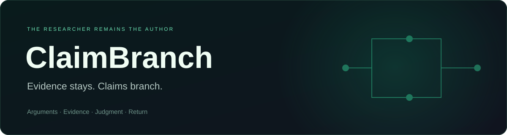
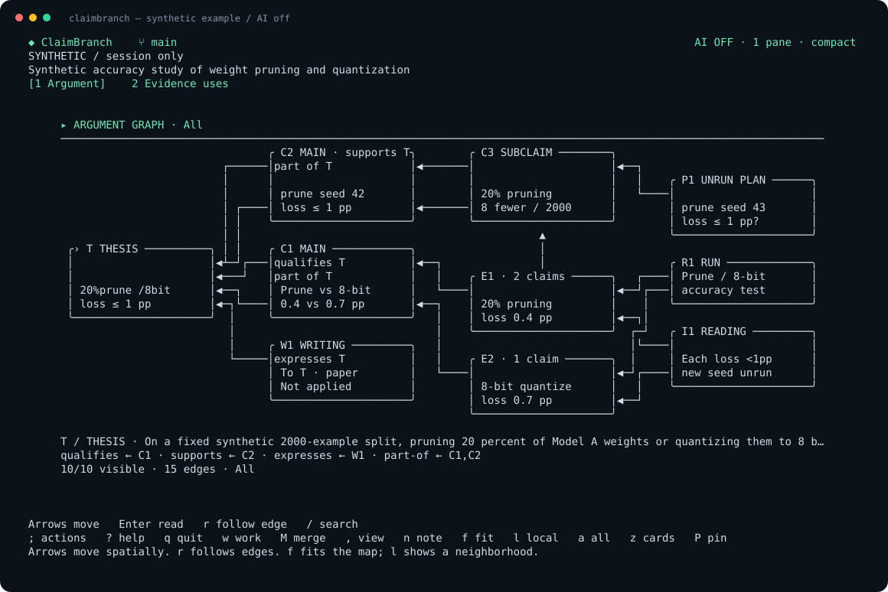

# ClaimBranch

<p align="center">
  
</p>

<p align="center">
  <strong>A research workspace for the argument behind your paper.</strong><br>
  Follow claims to evidence. Keep your reason. Pick up where you left off.
</p>

<p align="center">
  <a href="https://github.com/iNtuitionP/ClaimBranch/actions/workflows/docs.yml"></a>
  
  
  <a href="LICENSE"></a>
  <a href="https://github.com/iNtuitionP/ClaimBranch/stargazers"></a>
</p>

<p align="center">
  <a href="https://github.com/iNtuitionP/ClaimBranch/releases/tag/v0.1.0-alpha.2">Download alpha</a> ·
  <a href="#quick-start">Quick start</a> ·
  <a href="#your-own-paper">Your own paper</a> ·
  <a href="#what-works-today">Features</a> ·
  <a href="#ai-status">AI status</a> ·
  <a href="docs/README.md">Docs</a> ·
  <a href="https://github.com/iNtuitionP/ClaimBranch/issues">Feedback</a>
</p>

Git remembers which files changed. Experiment trackers remember which run won.
**ClaimBranch helps you remember why you changed your mind.**

Build the paper's argument from its thesis to claims, observations and experiments.
Form your judgment in that context, record your reason once, and return to the
same evidence and unfinished work later.

> **Personal terminal alpha.** Manual research, save/restart and local backup/restore
> work. Live AI is unavailable: the latest Codex test failed without a checked
> response. Manuscript files stay read-only.

<p align="center">
  
</p>
<p align="center"><sub>Bundled synthetic example, captured from <code>demo tui --snapshot --ai-off</code>. No real research data.</sub></p>

## Why ClaimBranch?

- **Read the argument.** Follow the thesis through claims to shared evidence and
  experiments, with typed connections and their rationale.
- **Make the judgment once.** Write while interpreting the result; reuse that
  judgment and reason when recording the consequence.
- **Keep inconvenient evidence.** Corrections append history. Another
  interpretation does not make an earlier result disappear.
- **Return without losing the thread.** Notes, judgments, unfinished writing and
  saved history survive a fresh process or a local backup restore.
- **Keep authorship visible.** The AI design preserves proposal origins through
  human edits. A suggestion never becomes evidence or a decision automatically.

**Evidence stays. Claims branch. The researcher remains the author.**

## Quick start

Requires **Python 3.13**, Python's `curses`, working Git at `/usr/bin/git` and a Unix terminal.
The personal workflow uses the Python standard library: no Python packages,
API key, browser, native approval key or model server is needed.

```sh
git clone https://github.com/iNtuitionP/ClaimBranch.git
cd ClaimBranch
python3.13 -m claimbranch doctor
python3.13 -m claimbranch demo tui --ai-off
```

The demo opens a synthetic paper and keeps work only for the running session.
To see plain output without an interactive terminal:

```sh
python3.13 -m claimbranch demo tui --snapshot --ai-off
```

**macOS is locally verified.** Ubuntu/macOS CI is configured for portable checks.
SSH/tmux, physical IME, unfamiliar-user usability and Windows product support
remain unverified. [Setup and support details →](docs/development/workflow.md#personal-terminal-alpha-source)

## Your own paper

Use an existing local Git paper with a UTF-8 `.tex` source. Add one marked block
yourself in your editor; ClaimBranch reads it without changing your manuscript:

```tex
% claimbranch:start id=anchor
Your paper wording goes here.
% claimbranch:end id=anchor
```

Create a new private work directory **outside every Git repository**:

```sh
mkdir -m 700 "$HOME/claimbranch-work"
python3.13 -m claimbranch project init \
  --directory "$HOME/claimbranch-work" \
  --paper-root /path/to/your-paper \
  --manuscript paper.tex
```

Replace the paper path and filename with your own. Init asks for the title,
working thesis and first unresolved question. Read the preview, then type
`create`. Your project starts with your writing and no fabricated observations.
To resume after quitting:

```sh
python3.13 -m claimbranch project open --directory "$HOME/claimbranch-work"
```

| In the terminal | What it does |
|---|---|
| Arrow keys / `Enter` | Move through the graph / read a record |
| `r` | Follow a recorded relationship |
| `;` / `?` | Open named actions / show help |
| `n` / `e` | Write a node note / write your judgment and reason |
| `Ctrl+S` / `Esc` in an editor | Keep writing / retain unfinished input separately |
| `q` | Save personal work and quit |

Start with **Draft a result and source**, then explicitly confirm what you
observed. Add claims and typed relationships with your reason. **Record selected
reasoning personally** reviews the consequence in the same context.
Source references are not opened or scientifically verified automatically.

[Full authoring guide →](docs/development/workflow.md#personal-project-writing-in-the-terminal)
 · [Six tasks to try →](docs/validation/cases/saturation.md#personal-alpha-feedback-tasks)

## Save, back up, return

Close the TUI. Create a new private backup directory outside Git:

```sh
mkdir -m 700 "$HOME/claimbranch-backup"
python3.13 -m claimbranch project backup \
  --directory "$HOME/claimbranch-work" \
  --archive-directory "$HOME/claimbranch-backup"
```

Restore into another new private directory:

```sh
mkdir -m 700 "$HOME/claimbranch-restored"
python3.13 -m claimbranch project restore \
  --directory "$HOME/claimbranch-restored" \
  --archive-directory "$HOME/claimbranch-backup"
python3.13 -m claimbranch project open --directory "$HOME/claimbranch-restored"
```

Backups contain **saved** project history and kept/unfinished writing. They exclude
unsaved input, manuscript files and external experiment artifacts. Personal files
and backups are **unencrypted**; private permissions do not stop another
unrestricted process running as the same user.

[Backup, export and recovery details →](docs/development/workflow.md#personal-project-writing-in-the-terminal)

## What works today

| Capability | Current availability |
|---|---|
| Thesis, main/subclaims, shared evidence and typed relationships | Manual personal workspace |
| Result capture, explicit confirmation and append-only correction | Available |
| Judgment, reason, notes and unfinished writing | Save and resume |
| Local backup/export and fresh-directory restore | Available |
| Hypothetical impact and graph comparison | Available; creates no evidence |
| AI proposal selection, editing and retained origin | Offline rehearsals and internal adapters |
| Provider configuration and exact unsent context preview | Available; sends nothing |
| Live AI requests | **Unavailable** |
| Automatic manuscript editing, protected acceptance and debt closure | Deferred |

This is a finite experimental alpha, not a validated research product. Current
bounds include 8 episodes/runs, 16 observations and one selected reasoning merge
per episode. [Scope and limits →](docs/product/releases/validation-prototype.md#55-source-delivery-readiness)

## AI status

The intended flow: select context, inspect what will be sent, request critique,
compare and edit suggestions, then record **your** judgment. AI stays optional
and proposal-only.

API and Codex-login profiles currently prepare unsent input. The live gate
remains closed. A model catalog or started turn is not a successful AI response.
There is no automatic fallback, background request or manuscript write.
Manual work remains usable with AI disabled.

[Connection preparation and current limits →](docs/development/workflow.md#personal-llm-configuration-and-unsent-preview)

## Help shape it

Try the [feedback tasks](docs/validation/cases/saturation.md#personal-alpha-feedback-tasks)
with disposable work, then [open an issue](https://github.com/iNtuitionP/ClaimBranch/issues).
Tell us your task, what happened, and where you lost the argument, your reason
or your writing. Include your OS, Python version and visible error.
Keep research files, backups and credentials private.

If preserving the reasoning behind a paper matters to you, star the repository
and follow its development. Concrete feedback improves the next version.

For contributors:

```sh
python3.13 scripts/verify.py --scope alpha --scope harness --temp-root /private/tmp
```

On Linux, use an existing temporary directory outside Git such as `/tmp`.
Read [the contributor workflow](docs/development/workflow.md) and
[AGENTS.md](AGENTS.md) before changing behavior.

## Documentation

- [Documentation map](docs/README.md) — canonical sources and reading paths.
- [Product philosophy](docs/product/product-spec.md#1-product-definition) — the
  researcher outcome behind graphs, provenance and understanding.
- [Product contracts](docs/product/product-spec.md) — intended behavior beyond this alpha.
- [Architecture decisions](docs/architecture/decisions/README.md) — boundaries and rationale.
- [Implementation plan](docs/plans/active/2026-08-04-claimbranch-v1-and-gpu-systems.md#alpha-feedback-and-publication-sequence)
  — verified progress and remaining work.

## License

Released under the [MIT License](LICENSE).
